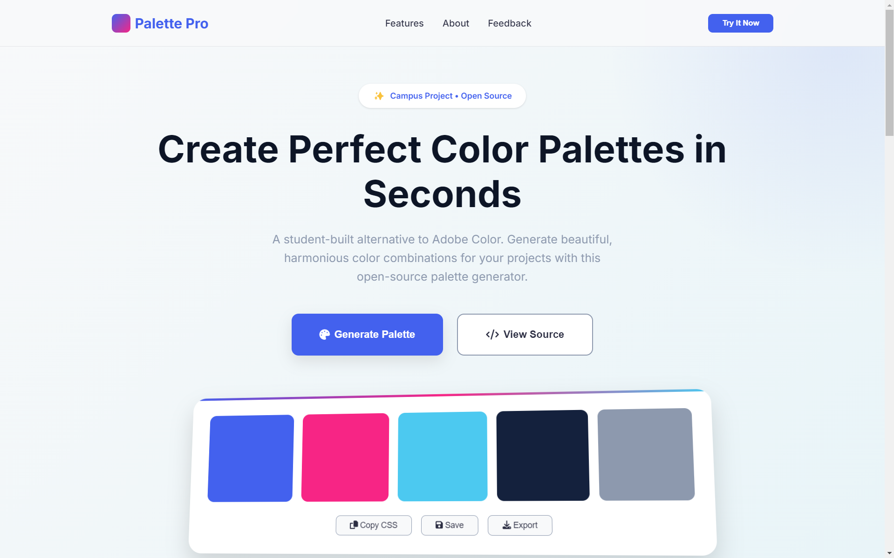

# 🎨 Palette Pro – Professional Color Palette Generator

[]()
[]()
[]()
[](LICENSE)
[](https://github.com/Ipangbbd/palette-pro/stargazers)

A **pro-level color palette generator** – create, export, and share palettes with ease.  
Built with **HTML, CSS, and JavaScript**, fully responsive, and open source.  

---

## 📸 Preview



---

## ✨ Features

- ⚡ **Instant Palette Generation** – one click, endless combinations  
- 📋 **Copy to Clipboard** – copy HEX codes instantly  
- 📂 **Export Options** – CSS, SCSS, JSON formats  
- 📱 **Responsive Design** – works smoothly on all devices  
- 📨 **Feedback Form** – powered by Web3Forms  
- 🆓 **Free & Open Source** – no hidden limits  

---

## 🗂 Project Structure

```

palette-pro/
├── assets/
│   ├── index.html
│   ├── script.js
│   └── style.css
├── index.html
├── script.js
└── style.css

````

---

## 🚀 Getting Started

1. Clone the repository:  
   ```bash
   git clone https://github.com/Ipangbbd/palette-pro.git
````

2. Open `index.html` in your browser
3. Click **Generate Palette** and explore

---

## 🎮 Usage

* 🎨 Generate palettes instantly with the button
* 📋 Copy HEX values with one click
* 💾 Export palettes to CSS, SCSS, or JSON
* ⭐ Submit feedback via the built-in rating form

---

## 🛠 Tech Stack

* **HTML5** – structure
* **CSS3** – styling & responsive layout
* **JavaScript (ES6)** – logic & interactivity
* **Font Awesome** – icons
* **Web3Forms** – feedback form integration
* **Inter** – modern typography

---

## 🗺 Roadmap

* [ ] Save palettes locally / export as image
* [ ] Dark mode toggle
* [ ] Advanced palette customization (manual input, gradients)
* [ ] Share palettes via links or embeds
* [ ] Integration with design tools (Figma, Adobe)

---

## 🤝 Contributing

Want to improve Palette Pro?

1. Fork this repo
2. Create your branch: `git checkout -b feat/new-feature`
3. Commit changes: `git commit -m "feat: add new feature"`
4. Push & open a Pull Request 🚀

---

## 📜 License

Released under the **MIT License** – see the [LICENSE](LICENSE) file.

---

👨‍💻 Developed by [@ipangbbd](https://github.com/ipangbbd)
```
